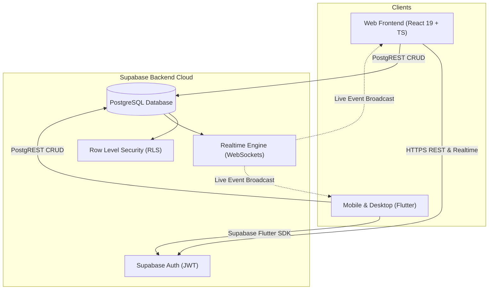
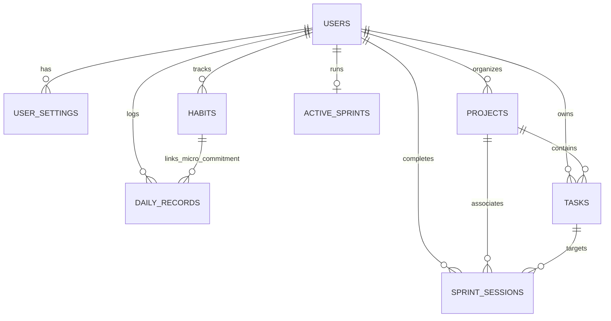

# Burgusbroos: Requirements & Implementation Specification

> **Status:** APPROVED & ARCHITECTED  
> **Target Audience:** Full-Stack & Mobile Engineers  
> **Key Constraint:** Exact visual & functional parity with the existing React frontend. Zero redesign of UI layouts, colors, or typography.

---

## 1. Executive Summary & Product Intent

### 1.1 Objective
**Burgusbroos** is a minimalist, cognitive-momentum productivity platform built on tiny compounding daily actions. It combines:
1. **Simple Mode**: A distraction-free grounding view with a single **Daily Highlight**, a habit-tied **Micro-Commitment**, and an uncluttering **Brain Dump** with rapid line-to-task promotion.
2. **Advanced Mode**: A 3-bucket triage board (**Must**, **Should**, **Could**), reality-based Pomodoro/Focus sprint sessions with live **Creative Log** capture, habit streak tracking, and weekly momentum reports.

### 1.2 Cross-Platform Architecture Goal
To scale Burgusbroos across **Web, iOS, Android, macOS, and Windows**, the architecture transitions from browser-only `localStorage` to an **offline-first cloud architecture**:
- **Backend Database & Realtime**: [Supabase](https://supabase.com) (PostgreSQL 15+, Row-Level Security, GoTrue Auth, Realtime WebSockets).
- **Web Client**: Existing React 19 + TypeScript + Tailwind CSS frontend, enhanced with transparent Supabase synchronization while preserving 100% of the UI design.
- **Cross-Platform Client**: Flutter application mirroring the exact Apple-clean aesthetic, micro-interactions, typography, and state behavior.

---

## 2. Supabase Backend Specification

### 2.1 Database Entities & Relationships
The backend schema directly translates the domain models into normalized, relational PostgreSQL tables protected by Row-Level Security (`auth.uid() = user_id`).

### 2.2 Table Definitions & Constraints

#### 1. `user_settings`
Stores user mode preferences, start-of-week settings, sound/nudges, and dismissed hint flags.
- `user_id`: `UUID PRIMARY KEY REFERENCES auth.users(id) ON DELETE CASCADE`
- `mode`: `app_mode NOT NULL DEFAULT 'simple'` (Enum: `'simple'`, `'advanced'`)
- `week_start_day`: `week_start_day NOT NULL DEFAULT 'monday'` (Enum: `'monday'`, `'sunday'`)
- `gentle_nudges_enabled`: `BOOLEAN NOT NULL DEFAULT true`
- `sound_enabled`: `BOOLEAN NOT NULL DEFAULT false`
- `dismissed_hints`: `JSONB NOT NULL DEFAULT '{}'::jsonb`
- `created_at` / `updated_at`: `TIMESTAMPTZ`

#### 2. `daily_records`
Stores daily grounding entries for Simple Mode and the top summary card of Advanced Mode.
- `id`: `UUID PRIMARY KEY DEFAULT uuid_generate_v4()`
- `user_id`: `UUID NOT NULL REFERENCES auth.users(id) ON DELETE CASCADE`
- `date`: `DATE NOT NULL` (Unique constraint on `(user_id, date)`)
- `brain_dump`: `TEXT NOT NULL DEFAULT ''`
- `daily_highlight_text`: `TEXT NOT NULL DEFAULT ''`
- `daily_highlight_done`: `BOOLEAN NOT NULL DEFAULT false`
- `daily_highlight_completed_at`: `TIMESTAMPTZ`
- `micro_commitment_text`: `TEXT NOT NULL DEFAULT ''`
- `micro_commitment_done`: `BOOLEAN NOT NULL DEFAULT false`
- `micro_commitment_habit_id`: `UUID REFERENCES habits(id) ON DELETE SET NULL`
- `micro_commitment_completed_at`: `TIMESTAMPTZ`
- `created_at` / `updated_at`: `TIMESTAMPTZ`

#### 3. `projects`
Categorizes tasks and focus sprints.
- `id`: `UUID PRIMARY KEY DEFAULT uuid_generate_v4()`
- `user_id`: `UUID NOT NULL REFERENCES auth.users(id) ON DELETE CASCADE`
- `name`: `TEXT NOT NULL`
- `description`: `TEXT`
- `color`: `TEXT DEFAULT '#6366F1'`
- `target_date`: `DATE`
- `created_at` / `updated_at`: `TIMESTAMPTZ`

#### 4. `tasks`
Implements the 3-bucket triage system (`must`, `should`, `could`).
- `id`: `UUID PRIMARY KEY DEFAULT uuid_generate_v4()`
- `user_id`: `UUID NOT NULL REFERENCES auth.users(id) ON DELETE CASCADE`
- `name`: `TEXT NOT NULL`
- `bucket`: `bucket_type NOT NULL DEFAULT 'must'` (Enum: `'must'`, `'should'`, `'could'`)
- `status`: `task_status NOT NULL DEFAULT 'not_started'` (Enum: `'not_started'`, `'in_progress'`, `'done'`, `'skipped'`)
- `priority`: `task_priority NOT NULL DEFAULT 'medium'` (Enum: `'high'`, `'medium'`, `'low'`)
- `due_date`: `DATE`
- `project_id`: `UUID REFERENCES projects(id) ON DELETE SET NULL`
- `notes`: `TEXT`
- `estimated_minutes`: `INTEGER`
- `order`: `INTEGER NOT NULL DEFAULT 0`
- `completed_at`: `TIMESTAMPTZ`
- `created_at` / `updated_at`: `TIMESTAMPTZ`

#### 5. `habits`
Tracks micro compounding routines and streaks.
- `id`: `UUID PRIMARY KEY DEFAULT uuid_generate_v4()`
- `user_id`: `UUID NOT NULL REFERENCES auth.users(id) ON DELETE CASCADE`
- `name`: `TEXT NOT NULL`
- `current_streak`: `INTEGER NOT NULL DEFAULT 0`
- `best_streak`: `INTEGER NOT NULL DEFAULT 0`
- `last_completed_date`: `DATE`
- `created_at` / `updated_at`: `TIMESTAMPTZ`

#### 6. `sprint_sessions`
Historical record of completed or ended focus sessions with logged ideas.
- `id`: `UUID PRIMARY KEY DEFAULT uuid_generate_v4()`
- `user_id`: `UUID NOT NULL REFERENCES auth.users(id) ON DELETE CASCADE`
- `task_id`: `UUID REFERENCES tasks(id) ON DELETE SET NULL`
- `task_name`: `TEXT`
- `bucket`: `bucket_type`
- `project_id`: `UUID REFERENCES projects(id) ON DELETE SET NULL`
- `start_time`: `TIMESTAMPTZ NOT NULL`
- `end_time`: `TIMESTAMPTZ NOT NULL`
- `planned_duration_sec`: `INTEGER NOT NULL DEFAULT 1500`
- `actual_duration_sec`: `INTEGER NOT NULL DEFAULT 0`
- `focus_quality`: `focus_quality` (Enum: `'locked_in'`, `'distracted'`, `'rough'`)
- `ended_early`: `BOOLEAN NOT NULL DEFAULT false`
- `notes`: `TEXT`
- `creative_takeaway`: `TEXT`
- `creative_log`: `JSONB NOT NULL DEFAULT '[]'::jsonb`
- `created_at`: `TIMESTAMPTZ NOT NULL DEFAULT timezone('utc'::text, now())`

#### 7. `active_sprints` (Realtime Multi-Device Sync)
Allows an in-progress sprint on the desktop web app to be seamlessly viewed and resumed on the mobile app.
- `user_id`: `UUID PRIMARY KEY REFERENCES auth.users(id) ON DELETE CASCADE`
- `is_running`: `BOOLEAN NOT NULL DEFAULT false`
- `is_paused`: `BOOLEAN NOT NULL DEFAULT false`
- `task_id`: `UUID REFERENCES tasks(id) ON DELETE SET NULL`
- `task_name`: `TEXT`
- `bucket`: `bucket_type`
- `project_id`: `UUID REFERENCES projects(id) ON DELETE SET NULL`
- `start_timestamp`: `BIGINT NOT NULL DEFAULT 0` (Epoch milliseconds)
- `accumulated_sec`: `INTEGER NOT NULL DEFAULT 0`
- `planned_duration_sec`: `INTEGER NOT NULL DEFAULT 1500`
- `creative_log`: `JSONB NOT NULL DEFAULT '[]'::jsonb`
- `updated_at`: `TIMESTAMPTZ`

---

## 3. Visual & Design Parity Specification

The frontend design must remain exact. Both the React web application and the Flutter cross-platform client strictly share the following visual design system:

| Design Dimension | Specification | Implementation in Flutter | Implementation in Web |
|---|---|---|---|
| **Canvas Background** | Ultra-clean off-white `#FBFBFD` | `Color(0xFFFBFBFD)` | `bg-[#fbfbfd]` |
| **Card Surface** | Pure white `#FFFFFF` | `Color(0xFFFFFFFF)` | `bg-white` |
| **Card Border** | Subtle translucent `rgba(0, 0, 0, 0.06)` | `Color(0x0F000000)` (1px) | `border-black/[0.06]` |
| **Soft Elevation** | 0 1px 3px rgba(0,0,0,0.02), 0 8px 24px rgba(0,0,0,0.03) | Custom `AppTheme.cardShadow` | `.apple-card` |
| **Primary Typography** | `Plus Jakarta Sans` (-0.015em letter spacing) | `GoogleFonts.plusJakartaSans()` | `var(--font-sans)` |
| **Display Typography** | `Outfit` (-0.025em letter spacing) | `GoogleFonts.outfit()` | `var(--font-display)` |
| **Monospace / Timer** | `JetBrains Mono` | `GoogleFonts.jetbrainsMono()` | `var(--font-mono)` |
| **Must Bucket Theme** | Orange `#EA580C` / Light `#FFF7ED` | `AppColors.bucketMust` | `orange-600` / `orange-50` |
| **Should Bucket Theme**| Indigo `#6366F1` / Light `#EEF2FF` | `AppColors.bucketShould` | `indigo-500` / `indigo-50` |
| **Could Bucket Theme** | Emerald `#10B981` / Light `#ECFDF5` | `AppColors.bucketCould` | `emerald-500` / `emerald-50` |

---

## 4. User Stories & Acceptance Criteria

### Group 1: Grounding & Simple Mode
- **AC-1 (Daily Highlight Persistence)**:
  - *Given* an active date, *When* the user types into the Daily Highlight input and checks the checkbox, *Then* the state is updated locally and upserted into `daily_records` with `daily_highlight_done = true` and `daily_highlight_completed_at` populated.
- **AC-2 (Micro-Commitment Habit Connection)**:
  - *Given* a micro-commitment linked to a habit, *When* toggled done, *Then* the associated habit streak increments by 1 for today.
- **AC-3 (Brain Dump Line Promotion)**:
  - *Given* lines of text in the Brain Dump textarea, *When* clicking the promotion arrow next to a line, *Then* a new task is immediately created in the **Must** bucket with status `not_started`.

### Group 2: 3-Bucket Task Triage (Advanced Mode)
- **AC-4 (3-Bucket Segregation)**:
  - *Given* tasks loaded, *When* navigating to the Tasks tab, *Then* tasks are cleanly grouped into three columns: Must Do (Orange), Should Do (Indigo), and Could Do (Emerald).
- **AC-5 (Quick Task Creation)**:
  - *Given* any bucket column, *When* typing into the inline input and pressing Enter, *Then* the task is appended to that bucket without opening a modal.
- **AC-6 (Task Reordering / Bucket Migration)**:
  - *Given* a task in any bucket, *When* dragging to another bucket or changing bucket in the modal, *Then* its `bucket` enum updates and order is preserved.

### Group 3: Focus Sprints & Creative Logs
- **AC-7 (Sprint Launch & Ticker Accuracy)**:
  - *Given* a task, *When* clicking the Sprint icon, *Then* a 25-minute (or task estimated) timer begins ticking every second.
- **AC-8 (Mid-Sprint Creative Logging)**:
  - *Given* an active running sprint, *When* the user types a thought and selects type (`insight` | `idea` | `breakthrough` | `note`), *Then* the entry is logged with the elapsed second timestamp and displayed in the live feed.
- **AC-9 (Sprint Completion & Auto-Mark Task)**:
  - *Given* an active sprint linked to a task, *When* the user clicks "Complete Sprint" with "Mark task done" enabled, *Then* the sprint session is saved to `sprint_sessions` and the task status transitions to `done`.

### Group 4: Cloud Sync & Offline Reliability
- **AC-10 (Offline-First Graceful Fallback)**:
  - *Given* the user opens the web or mobile app without internet or before configuring Supabase credentials, *Then* all features work seamlessly with local storage, without throwing unhandled exceptions.
- **AC-11 (Cloud Sync Upon Connection)**:
  - *Given* valid Supabase credentials in `.env.local` or `supabase_config.dart`, *When* an authenticated user creates/updates tasks or records, *Then* they are synced to PostgreSQL via Row-Level Security.

---

## 5. File Inventory & Implementation Assets

The following files have been created to deliver this implementation:

| Path | Purpose |
|---|---|
| [`supabase/migrations/20260927000000_init_burgusbroos.sql`](file:///c:/Users/ffdru/Desktop/burgusbroos/supabase/migrations/20260927000000_init_burgusbroos.sql) | Complete PostgreSQL schema DDL, RLS policies, enums, triggers & realtime publications |
| [`supabase/seed.sql`](file:///c:/Users/ffdru/Desktop/burgusbroos/supabase/seed.sql) | Starter developer seed data |
| [`supabase/README.md`](file:///c:/Users/ffdru/Desktop/burgusbroos/supabase/README.md) | Setup and deployment documentation for Supabase Cloud and CLI |
| [`src/services/supabase.ts`](file:///c:/Users/ffdru/Desktop/burgusbroos/src/services/supabase.ts) | React web Supabase client initializer with safe offline fallback |
| [`src/services/supabaseSync.ts`](file:///c:/Users/ffdru/Desktop/burgusbroos/src/services/supabaseSync.ts) | Bi-directional data synchronization service for React |
| [`.env.example`](file:///c:/Users/ffdru/Desktop/burgusbroos/.env.example) | Environment variable template with `VITE_SUPABASE_URL` and `VITE_SUPABASE_ANON_KEY` |
| [`burgusbroos_flutter/pubspec.yaml`](file:///c:/Users/ffdru/Desktop/burgusbroos/burgusbroos_flutter/pubspec.yaml) | Cross-platform Flutter dependencies and package spec |
| [`burgusbroos_flutter/lib/constants/theme.dart`](file:///c:/Users/ffdru/Desktop/burgusbroos/burgusbroos_flutter/lib/constants/theme.dart) | Exact Apple design system, typography, colors & soft shadow styles |
| [`burgusbroos_flutter/lib/constants/supabase_config.dart`](file:///c:/Users/ffdru/Desktop/burgusbroos/burgusbroos_flutter/lib/constants/supabase_config.dart) | Supabase connection endpoints for Flutter |
| [`burgusbroos_flutter/lib/models/models.dart`](file:///c:/Users/ffdru/Desktop/burgusbroos/burgusbroos_flutter/lib/models/models.dart) | Strongly typed Dart data models matching TypeScript interfaces |
| [`burgusbroos_flutter/lib/services/supabase_service.dart`](file:///c:/Users/ffdru/Desktop/burgusbroos/burgusbroos_flutter/lib/services/supabase_service.dart) | Flutter Supabase client and query layer |
| [`burgusbroos_flutter/lib/providers/app_provider.dart`](file:///c:/Users/ffdru/Desktop/burgusbroos/burgusbroos_flutter/lib/providers/app_provider.dart) | State management mirroring `AppContext.tsx` with sprint ticker & sync |
| [`burgusbroos_flutter/lib/widgets/app_header.dart`](file:///c:/Users/ffdru/Desktop/burgusbroos/burgusbroos_flutter/lib/widgets/app_header.dart) | Minimalist header with mode toggle pill & date navigator |
| [`burgusbroos_flutter/lib/views/simple_mode_view.dart`](file:///c:/Users/ffdru/Desktop/burgusbroos/burgusbroos_flutter/lib/views/simple_mode_view.dart) | Daily Highlight, Micro-Commitment, and Brain Dump promotion view |
| [`burgusbroos_flutter/lib/views/tasks_view.dart`](file:///c:/Users/ffdru/Desktop/burgusbroos/burgusbroos_flutter/lib/views/tasks_view.dart) | 3-Bucket triage columns (Must / Should / Could) with quick task input |
| [`burgusbroos_flutter/lib/views/sprint_view.dart`](file:///c:/Users/ffdru/Desktop/burgusbroos/burgusbroos_flutter/lib/views/sprint_view.dart) | Circular countdown sprint timer with live creative log drawer |
| [`burgusbroos_flutter/lib/main.dart`](file:///c:/Users/ffdru/Desktop/burgusbroos/burgusbroos_flutter/lib/main.dart) | Flutter application entry point and screen routing shell |

---

## 6. Deployment & Verification Checklist

- [x] Web frontend UI preserved 100% without altering existing CSS or components.
- [x] TypeScript compilation check passed (`npm run lint` / `tsc --noEmit` exits with code 0).
- [x] PostgreSQL migration file written with RLS policies, custom enums, and automatic `updated_at` triggers.
- [x] Cross-platform Flutter architecture created with exact visual styling, typography, and state parity.
- [ ] Connect live Supabase project by adding credentials to `.env.local` and running `supabase/migrations/20260927000000_init_burgusbroos.sql` in Supabase SQL Editor.
